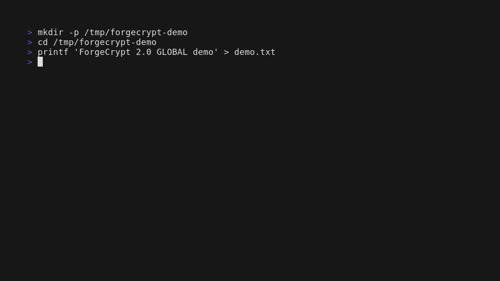

<div align="center">

# ForgeCrypt 2.0 GLOBAL

<p align="center">
  
</p>

**Strong file encryption. Simple commands. Linux first.**

[](https://github.com/abduforge/forgecrypt/releases/latest)
[](https://github.com/abduforge/forgecrypt/actions/workflows/ci.yml)
[](LICENSE)

**Encrypt any-size files, verify them without saving plaintext, and change passphrases — all with a small, easy-to-use Rust CLI.**

[Русская документация](README_RU.md) · [Releases](https://github.com/abduforge/forgecrypt/releases) · [Report a security issue](SECURITY.md)

</div>

---

## Get started in 30 seconds

1. Click **DOWNLOAD FOR LINUX** above and download the Linux archive from the latest release.
2. Extract the archive.
3. Open a terminal in the extracted folder and run:

```bash
./install.sh
```

4. Encrypt a file:

```bash
forgecrypt encrypt ./private.txt ./private.txt.fgc
```

ForgeCrypt asks for a passphrase twice. It does not show the passphrase while you type.

**No terminal?** Download the archive first. The detailed installation guide is below.

## What ForgeCrypt does

| You want to… | Run |
|---|---|
| Encrypt a file | `forgecrypt encrypt input output.fgc` |
| Decrypt a file | `forgecrypt decrypt input.fgc output` |
| Check that an encrypted file is authentic | `forgecrypt verify input.fgc` |
| Change its passphrase | `forgecrypt rekey input.fgc new-copy.fgc` |
| View public format information | `forgecrypt inspect input.fgc` |
| Check the build/runtime information | `forgecrypt doctor` |

**Simple rule:** ForgeCrypt never overwrites an existing output file. Choose a new output name.

## Why version 2.0 is different

- **Large-file streaming:** format v2 processes files in 1 MiB chunks instead of loading the whole file into RAM.
- **Authenticated chunks:** every chunk is authenticated independently and tied to its sequence number.
- **Truncation detection:** an authenticated final record detects incomplete files.
- **Verify without output:** `verify` checks the complete file and writes no plaintext file.
- **Streaming re-key:** `rekey` changes the passphrase through a bounded in-memory pipe; it does not create a plaintext temporary file.
- **Safer output handling:** the CLI stages output with owner-only permissions and publishes it only after the operation succeeds. Existing files are not replaced.
- **Legacy compatibility:** files in the v1 format created by ForgeCrypt 0.1.x and 1.2.x can still be decrypted, verified, inspected, and re-keyed. Legacy v1 files are limited to 16 MiB.

## Install

### Option A — download a release (recommended)

1. Open [GitHub Releases](https://github.com/abduforge/forgecrypt/releases/latest).
2. Download the Linux archive matching your system (`x86_64` for most Intel/AMD PCs).
3. Extract it and open a terminal in the extracted directory.
4. Run:

```bash
./install.sh
```

The installer places the executable in `~/.local/bin`. No root access is required. If the command is not found, add this directory to your `PATH`:

```bash
echo 'export PATH="$HOME/.local/bin:$PATH"' >> ~/.profile
. ~/.profile
```

### Option B — build from source

Requirements: Linux, Rust stable (1.85 or newer), and Cargo.

```bash
cargo fmt --all -- --check
cargo test --all-targets
cargo clippy --all-targets -- -D warnings
cargo build --release
./install.sh
```

## Commands explained

### Encrypt

```bash
forgecrypt encrypt ./document.pdf ./document.pdf.fgc
```

Creates a new encrypted file. ForgeCrypt asks for a new passphrase twice. Use a long, unique passphrase that you can keep safe.

### Decrypt

```bash
forgecrypt decrypt ./document.pdf.fgc ./document-restored.pdf
```

The CLI writes to a private temporary file. It publishes the requested output only after all chunks and the final authentication record have been verified. If authentication fails, the requested output is not created.

### Verify

```bash
forgecrypt verify ./document.pdf.fgc
```

Checks the password and the complete authentication of the encrypted file. Plaintext is discarded in memory; no plaintext output file is created.

### Change a passphrase (re-key)

```bash
forgecrypt rekey ./document.pdf.fgc ./document-new-key.pdf.fgc
```

ForgeCrypt asks for the current passphrase and then the new passphrase twice. For v2 files, it verifies and re-encrypts through a bounded in-memory channel without creating an intermediate plaintext file. A legacy v1 file (maximum 16 MiB) is opened in a zeroizing memory buffer and upgraded to v2. The original encrypted file remains unchanged.

### Inspect

```bash
forgecrypt inspect ./document.pdf.fgc
```

Shows public header information. **Inspect does not verify authenticity.** Use `verify` for that.

### Doctor and help

```bash
forgecrypt doctor
forgecrypt --help
forgecrypt --version
```

## Cryptographic design

ForgeCrypt uses established implementations; it does not invent a cipher or a cryptographic protocol.

| Purpose | Implementation |
|---|---|
| Password-based key derivation | Argon2id v1.3 |
| Authenticated encryption | XChaCha20-Poly1305 |
| Salt and per-record nonces | Operating-system CSPRNG via `getrandom` |
| Sensitive buffer cleanup | `zeroize` |
| Hidden terminal passphrase prompt | `rpassword` |

Format v2 uses a fresh 16-byte salt per file and a fresh 24-byte nonce per record. The file header, record kind, sequence number, plaintext length, nonce, and final total length are authenticated as associated data. The format uses fixed, validated Argon2id parameters (64 MiB memory, 3 iterations, 1 lane); a file cannot request arbitrary KDF memory or iteration counts.

See [docs/FORMAT.md](docs/FORMAT.md) for the binary format and [SECURITY.md](SECURITY.md) for security assumptions and reporting.

## Compatibility

ForgeCrypt 2.0 writes **format v2** for new encryptions. It can read **format v1** files from ForgeCrypt 0.1.x and 1.2.x. V1 is a legacy in-memory format limited to 16 MiB; v2 is the streaming format. The application version and the encrypted-file format version are different things.

## Important security notes

- ForgeCrypt protects files at rest. It is **not** a VPN, network tunnel, peer-to-peer protocol, or device identity system.
- This project has not yet received an independent security audit. Treat it as experimental and do not use it as the only protection for irreplaceable or high-value data.
- A weak or reused passphrase can be guessed offline. Use a long, unique passphrase.
- If you lose the passphrase, ForgeCrypt cannot recover the data. Keep a separate secure backup before deleting the original.
- File names, file sizes, and ordinary filesystem metadata are not hidden.
- Encryption cannot protect data after it has been decrypted on a compromised device, nor against malware, keyloggers, memory inspection, crash dumps, or an unlocked session.
- The CLI stages output in a mode-`0600` file in the destination directory and publishes it only after success. During `decrypt` this staging file contains plaintext. A sudden power loss or forced termination could leave a hidden `.forgecrypt-*.tmp` file behind; after an interrupted decrypt, treat any such file as plaintext.
- Secure deletion cannot be guaranteed on SSDs, copy-on-write filesystems, snapshots, or journaled storage.

## Uninstall

```bash
./uninstall.sh
```

This removes the executable from `~/.local/bin`. It does not delete your encrypted files or passphrases.

## Development

```bash
cargo fmt --all -- --check
cargo test --all-targets
cargo clippy --all-targets -- -D warnings
cargo build --release
```

Contributions are welcome. Read [CONTRIBUTING.md](CONTRIBUTING.md) first. Please report suspected vulnerabilities privately using the instructions in [SECURITY.md](SECURITY.md).

---

**ForgeCrypt is part of the AbduForge ecosystem.**
